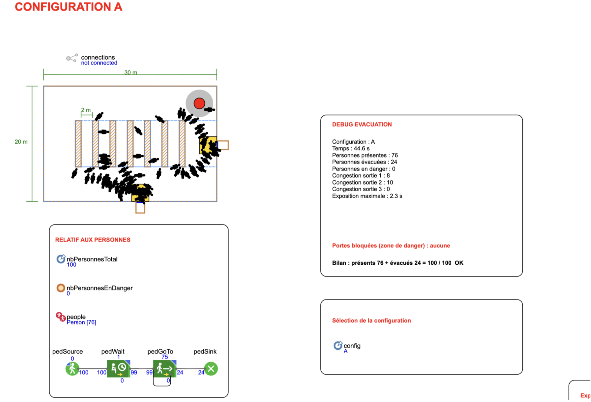

# Supermarket Evacuation Simulation

*October 2026 | AnyLogic · Agent-Based Simulation · Java*

Agent-based simulation of supermarket evacuation during a fire, focusing on **pedestrian behavior, congestion management, and evacuation strategies**.

Developed collaboratively by **Nina Perret and Mathieu Robinson** at Mines Saint-Étienne.

## Project Overview

This project investigates how emergency exit configurations and pedestrian decision-making strategies influence evacuation efficiency during a supermarket fire.

Developed using **AnyLogic and its Pedestrian Library**, the simulation models a 30 × 20 m supermarket with 100 pedestrians, incorporating:

- **Individual Behavior:** Randomized walking speeds and reaction times following an emergency alarm.
- **Fire and Smoke Propagation:** Expanding danger zones affecting pedestrian movement and exit accessibility.
- **Dynamic Exit Selection:** Exit choices based on distance and congestion, with a hysteresis mechanism to prevent oscillations.
- **Congestion Monitoring:** Real-time measurement of pedestrian density near emergency exits.

## Experimental Configurations

Three supermarket configurations were compared:

| Configuration | Number of Exits | Exit Width | Total Width |
|---|---|---|---|
| A | 2 | 1.5 m | 3 m |
| B | 3 | 1 m | 3 m |
| C | 3 | 1.5 m | 4.5 m |

Additional experiments evaluated the influence of alarm delays, smoke propagation speed, and congestion weighting.

Multiple simulation replications were performed to account for variability in pedestrian behavior.

## Performance Indicators

Evacuation performance was evaluated using:

- **Evacuation Times:** T90 and T100 (time to evacuate 90% and 100% of pedestrians).
- **Individual Evacuation Time:** Average and maximum walking time.
- **Pedestrian Safety:** Smoke exposure and number of individuals reaching the danger threshold.
- **Congestion:** Average and maximum pedestrian density near exits.
- **Exit Distribution:** Proportion of pedestrians using each exit.

## Key Findings

- Increasing the **number of exits** improves evacuation efficiency, even with identical total exit widths.
- Increasing the **total exit width** further reduces evacuation times.
- Congestion-aware exit selection improves pedestrian distribution across available exits.
- Introducing hysteresis prevents repeated switching between exits.

## Technologies

- **AnyLogic** – Agent-based simulation and Pedestrian Library
- **Java** – Simulation logic and pedestrian behavior
- **Statistical Analysis** – Multiple replications and sensitivity analysis

## Repository Structure

```text
├── supermarket_evacuation.alp      # AnyLogic simulation model
├── simulation_results.csv          # Experimental results
├── simulation_preview_config_A.png # Simulation screenshot
├── technical_report.pdf            # Detailed technical report
└── README.md
```

## Simulation Preview



*Example of the supermarket evacuation simulation (Configuration A).*

## Running the Simulation

1. Open `supermarket_evacuation.alp` in **AnyLogic**.
2. Select the desired supermarket configuration and simulation parameters.
3. Run the simulation and analyze the performance indicators.

## Documentation

For detailed modeling assumptions, experimental methodology, results, and limitations, see the [Technical Report](technical_report.pdf).
